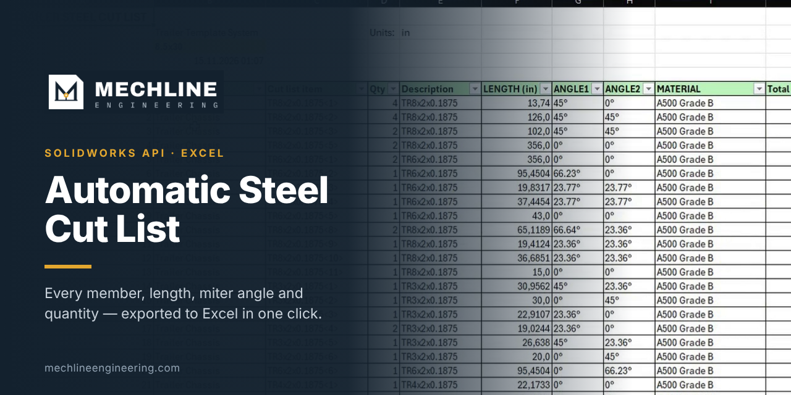
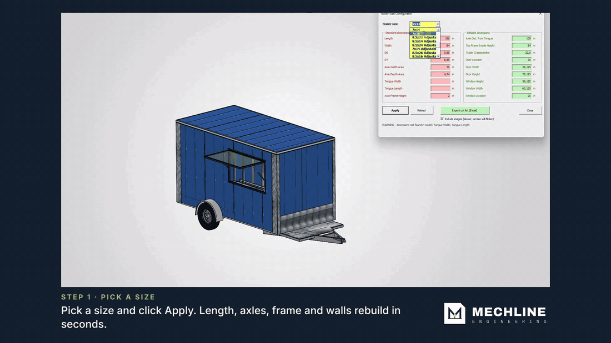

# Automatic Steel Cut List: SolidWorks to Excel

A SolidWorks macro that reads every structural member in a weldment assembly and writes a complete steel cut list to Excel in one click. It works with the parametric trailer template, so a new trailer size and its cut list are ready within seconds.

## How it works

1. **Pick a size and click Apply.** The trailer template rebuilds length, axles, frame and walls (see [solidworks-trailer-configurator](https://github.com/mechline-engineering/solidworks-trailer-configurator)).
2. **Click "Export cut list (Excel)".** The macro walks through the assembly and collects every structural member.
3. **Get the Excel cut list.** One row per cut item, with:

| Column | Example |
|---|---|
| Part | Trailer Chassis |
| Cut list item / description | TR8x2x0.1875 |
| Qty | 4 |
| Length (in) | 126.0 |
| Angle 1 / Angle 2 | 45° / 45° |
| Material | A500 Grade B |
| Total length (in) | 504.0 |
| Manufacturer | supplier link per profile |

4. **Material summary.** A second table totals each profile in inches and feet, so steel can be ordered right away.

No manual measuring, and no copying and pasting from SolidWorks into a spreadsheet.

## Built with

| | |
|---|---|
| CAD | SolidWorks weldments and cut lists |
| Automation | SolidWorks API, VBA |
| Output | Excel workbook: cut list and material summary |
| Units | Imperial (inches and feet) |

## Source code

This repository is a showcase. The macro was built for production use, so the source is not public.

**Want the same one-click cut list for your frames, skids, platforms or trailers?** We adapt it to your profiles, material names and spreadsheet format.

## Contact

**Mechline Engineering** – mechanical design, FEA and contract manufacturing for manufacturers in the US, Europe and Australia.

- Website: https://www.mechlineengineering.com
- Quote request: https://www.mechlineengineering.com/#quote
- Email: info@mechlineengineering.com
- More automation projects: https://github.com/mechline-engineering
